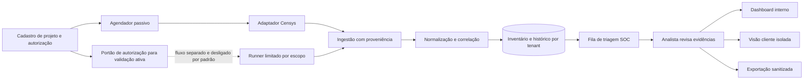

# Arquitetura alvo — IT4US SOC EASM

**Versão:** 1.0  
**Data:** 2026-11-05  
**Estado:** aplicação web single-node implementada em FastAPI/SQLite, mais CLI passivo. O diagrama mostra o fluxo atual e capacidades futuras; não representa implantação corporativa.

## Fluxo

## Componentes

1. **Cadastro e governança:** clientes, projetos, seeds autorizados, exclusões, validade, contatos, aprovador e histórico de mudanças.
2. **Agendador:** dispara consultas passivas por projeto respeitando frequência, orçamento e limites de API.
3. **Adaptador Censys:** camada isolada para a API escolhida. Não deve assumir que Censys Platform API e ASM API têm as mesmas credenciais, campos, limites ou direitos.
4. **Ingestão:** preserva referência da consulta e metadados do provedor; armazena o mínimo necessário e nunca grava credenciais.
5. **Normalizador/correlator:** resolve entidades e relações com confiança; conserva evidências que sustentam cada associação.
6. **Inventário e histórico:** armazena ativos e observações versionadas por tenant.
7. **Triage SOC:** fila com estado, prioridade explicável, responsável, comentários e trilha auditável.
8. **Interfaces:** console interno e área do cliente com autorização no servidor e escopo limitado ao projeto daquele usuário.
9. **Exportação:** artefato sanitizado e revisado; registra quem exportou, quando e quais filtros foram usados.
10. **Runner ativo opcional:** sistema independente, desabilitado por padrão; requer aprovação vigente, alvo permitido, técnica, limite, janela e kill switch. Não é parte do piloto passivo.

## Entidades mínimas

- `Tenant`: organização cliente e política de retenção.
- `Project`: unidade de escopo e configuração.
- `Authorization`: documento/referência, aprovador, seeds, exclusões, atividades permitidas, validade e estado.
- `Seed`: domínio, hostname, ASN, CIDR ou outra pista autorizada, com origem e confiança.
- `Asset`: host, hostname, web property, certificado ou relação, incluindo identificador canônico.
- `Observation`: fonte, timestamp observado/ingerido, consulta, campos mínimos, hash de evidência e validade estimada.
- `Relationship`: vínculo seed–ativo com tipo, evidência e confiança.
- `Exposure`: serviço/configuração/candidato, estado epistêmico, severidade operacional e fatores de prioridade.
- `Review`: decisão do analista, justificativa, evidência consultada e timestamp.
- `Alert`: mudança, regra, destinatários, estado e reconhecimento.
- `AuditEvent`: ator, ação, tenant/projeto, recurso e timestamp.

## Segurança e isolamento

- Identidade autenticada e RBAC para `analyst`, `reviewer`, `admin` e `customer_viewer`.
- Verificação de tenant e projeto no servidor em cada leitura e escrita; não confiar em filtros enviados pelo browser.
- Segredos em secret manager, acesso mínimo, rotação e redaction de logs.
- Criptografia em trânsito e repouso; trilha imutável para autorização, mudança de escopo, revisão e exportação.
- Retenção configurável por contrato; deleção verificável e exportação restrita.
- Sem dados de cliente em prompts de IA por padrão. Se IA for introduzida, limitar a resumos de evidência minimizada, exigir rastreabilidade e revisão humana.
- Testes com fixtures sintéticas para isolamento, duplicidade, atribuição incerta, expiração de autorização e limites de API.

## Contrato do fornecedor

Antes de escolher implementação, verificar nos termos e no console da conta:

- API liberada e papel exigido;
- plano, quotas, credits e custo de consultas;
- campos/datasets disponíveis;
- retenção e histórico;
- permissões para armazenamento, exportação e apresentação de dados a clientes;
- limites de rate e política de uso automatizado.

Documentação oficial inicial: [Platform API](https://docs.censys.com/reference/get-started), [ASM API](https://docs.censys.com/docs/asm-api), [datasets](https://docs.censys.com/docs/platform-datasets) e [tiers](https://docs.censys.com/docs/data-access-tiers-entitlements).
